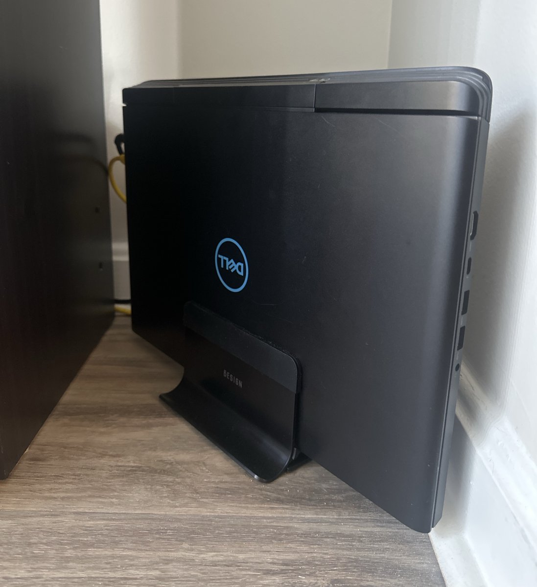
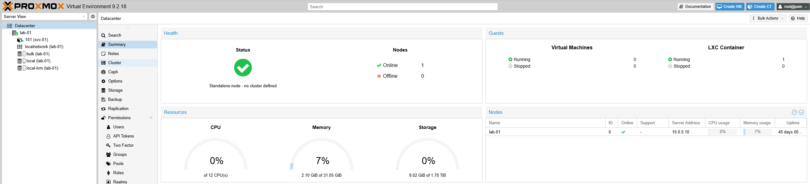
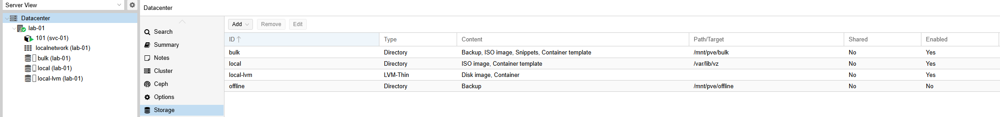
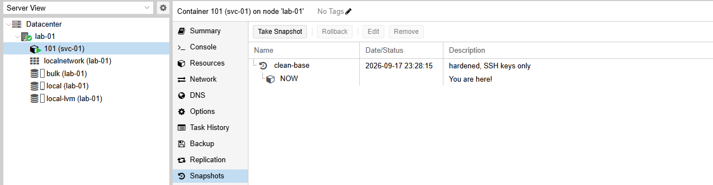
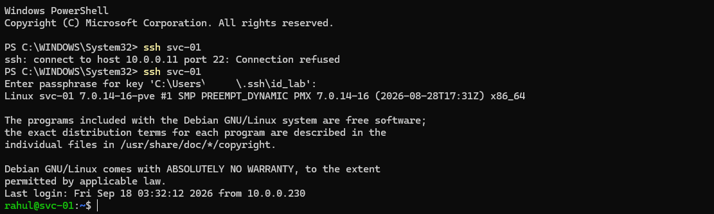
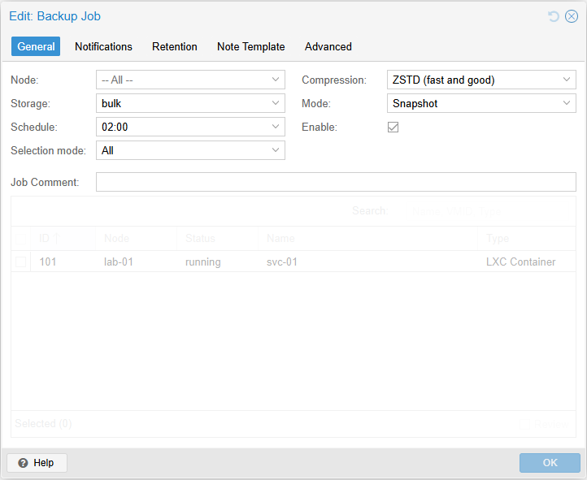

I work in security evaluation, which mostly means looking at systems from the outside and checking whether they do what they say. For a while now I've wanted a place where I could build things myself, break them on purpose, and not have to explain anything to anyone afterwards.

So I finally started a home lab. This post covers the first weekend. It isn't really a tutorial. It's closer to a log of what I did, what went wrong, and what I'd tell myself if I were starting again.

## The plan

There are three things I want to learn properly: cloud infrastructure, offensive security, and running AI models locally. My first instinct was to build something separate for each one. I talked myself out of that pretty quickly. Three half-finished labs is worse than one finished one.

So the idea is one platform, and the three learning tracks run on top of it.

That made the first weekend a bit dull, honestly. No Kubernetes, no Kali. Just a hypervisor, sensible storage, one container, and backups that I've actually tested. I've seen enough homelab posts that end in forty services and no working DNS, and I didn't want to be one of them.

## Hardware

The server is a Dell G7 7588. It's a 2018 gaming laptop with an i7-8750H that had been sitting in a drawer doing nothing.

I didn't expect a laptop to make a good server, but it has a few things going for it. The battery works like a small UPS, so a power blip doesn't take it down. It idles at a few watts, so running it all day costs almost nothing. And the screen and keyboard are always right there, which turned out to matter a lot later on.

It has 32 GB of RAM and a 1 TB SSD, which is plenty for a lab this size.

Before putting anything on it, I let Memtest86+ run seven full passes just to be safe. Bad RAM causes the kind of random crashes and silent corruption you can waste weeks blaming on something else, so an evening of testing up front felt worth it. No errors.

The laptop isn't the only machine involved, though. I built a new desktop recently, mostly for gaming: a Ryzen 7 9800X3D, an RTX 5070 Ti with 16 GB of VRAM, and DDR5-6000 memory. That's where the AI side of the lab will run. Running models locally is mostly about the GPU, and the laptop's 2018 mobile graphics card isn't up to it, so the desktop gets that job while the laptop stays on as the always-on server.



## Installing Proxmox

I went with Proxmox VE 9.2, installed straight onto the laptop. Windows is gone.



A few choices during the install that I'd make again:

**ext4 instead of ZFS.** I like ZFS, but it wants 4 to 8 GB of RAM for its cache, and with a single disk you don't get most of what makes it worth it. I'd rather give that memory to containers.

**A smaller root partition.** By default the installer gave the OS a quarter of the disk, which here was 238 GB. Proxmox itself uses about 10. I set the root size to 128 GB so the rest goes to the pool where guest disks live.

**Fixing the update repositories.** Out of the box, Proxmox points at its enterprise repository, which needs a paid subscription. Without one you get a 401, and apt treats any broken repository as a hard failure, so nothing would install at all. Switching to the free `pve-no-subscription` repo fixed it. It's the same packages, signed with the same keys.

### The lid problem

If a laptop is going to be a server, it has to keep running with the lid closed. On Linux that's a small systemd config file:

```ini
[Login]
HandleLidSwitch=ignore
HandleLidSwitchDocked=ignore
HandleLidSwitchExternalPower=ignore
```

My first attempt had `HandleLidSwitcExternalPower`. I'd dropped an "h". systemd didn't complain at all. It just quietly ignored a setting it didn't recognise, and the option stayed unset.

I only noticed because I asked the running service what it had actually loaded, instead of rereading my own file:

```bash
busctl get-property org.freedesktop.login1 /org/freedesktop/login1 \
  org.freedesktop.login1.Manager HandleLidSwitch HandleLidSwitchExternalPower HandleLidSwitchDocked
```

This came up again and again over the weekend. A config file tells you what you meant. The running system tells you what actually happened. Check the second one.

## Storage

The laptop has two internal drives, and I gave them very different jobs:

| Disk | What it holds |
|---|---|
| 1 TB NVMe | Guest disks, and nothing else |
| 1 TB 5400 RPM HDD | ISOs, templates and backups |

Proxmox lets you pick what kind of content each storage pool is allowed to hold, and I leaned on that a lot. The slow HDD isn't allowed to hold guest disks at all, so I can't accidentally put a VM on it. The 128 GB root partition isn't allowed to hold backups, so a backup job can't fill it up and take the host down with it.

I'd much rather take an option away than rely on remembering not to use it. That idea ended up shaping most of the decisions in this lab.



## The first container

The first guest is called `svc-01`. It's an unprivileged LXC container running Debian 13.

I went with a container instead of a VM because containers share the host's kernel. They start in about a second and use around 50 MB of RAM sitting idle. A VM takes half a minute or more to boot and wants a gigabyte or two. On a 32 GB machine, that adds up fast. My rough rule now is that everything is a container unless it needs its own kernel, isn't Linux, or is something I plan to attack.

"Unprivileged" means root inside the container is mapped to a normal, powerless user on the host. If someone gets root in the container, they still don't have the hypervisor.

Then I locked it down the usual way. I created a regular user, set up an SSH key just for the lab, and turned off password logins and root logins. I tested both sides: my key worked, and root got `Permission denied (publickey)`. I wrote "hardened" in my notes and moved on.

It was not hardened.

A bit later I typed `sudo` and got this:

```
rahul is not in the sudoers file.
```

I'd never actually added my user to the `sudo` group. And since I'd just switched off root logins over SSH, `sudo` was the only way left to manage the container over the network. I had locked myself out of my own admin access and written it down as a security improvement.

The Proxmox console got me out of it. It gives you a terminal on the container that doesn't go through SSH at all, so I logged in as root there, ran `usermod -aG sudo`, and that was that. It's the main thing I took away from the weekend: before you change how you log in to something, make sure you have a second way in that doesn't depend on the thing you're changing. On a cloud server that's the serial console. On real hardware it's usually IPMI. If there's no second way in, don't make the change remotely.

## Breaking it on purpose

This is the part I'd recommend to anyone setting up a lab.

Proxmox can snapshot a container in a couple of seconds. But I didn't want to just assume snapshots worked, so I tested one properly:



1. I took a snapshot called `clean-base`. I made sure to take it after fixing `sudo`, because a snapshot saves things exactly as they are. If I'd taken it before the fix, rolling back would have brought the bug back too.
2. I broke SSH as thoroughly as I could. I uninstalled the OpenSSH server and deleted `/etc/ssh`.
3. I checked that I really was locked out.
4. I rolled back to the snapshot.
5. I connected again.



The whole thing took less than two minutes. My favourite detail is that SSH didn't show a host key warning when I reconnected. The container came back with the exact same host keys it had before, so as far as my desktop was concerned, nothing had changed. That's how I knew it was a real restore and not a fresh install that happened to look similar.

It's quick because the storage is thin provisioned. A snapshot only keeps track of the blocks that change after it's taken, so making one costs almost nothing and rolling back just throws those changes away.

Once undoing a mistake takes thirty seconds, you stop being careful in the bad way. You just try things.

## Backups

A snapshot sits on the same drive as the container it protects. That's fine for undoing a bad change, but if the NVMe dies, the snapshot dies with it. So I set up backups in a few layers:

| Layer | Where it lives | How often | What it saves me from |
|---|---|---|---|
| Snapshot | Same NVMe | Before anything risky | A bad change |
| Nightly backup | The HDD | Every night | A dead NVMe, a deleted container |
| Offline copy | An external Thunderbolt SSD that stays unplugged | Once a month | Ransomware, a bad `rm`, a power surge |
| Offsite | Not done yet | | Theft, fire |

Two small settings ended up mattering more than I expected.

The nightly job is set to back up all guests, not a list I picked. That means any new container is covered from the moment it exists, without me having to remember to add it.



Retention is set on purpose: seven nightly backups and three offline ones. I didn't want to leave it on whatever the default happened to be.

The offline copy is the one I think most people skip, and it's the one I care about most. If the drive isn't plugged in, nothing running on the server can encrypt it or delete it. This month's offline backup of `svc-01` took about seven seconds.

## The Thunderbolt SSD that wasn't there

The offline drive gave me my favourite bit of troubleshooting all weekend.

I plugged it in and the kernel log picked it up straight away. `boltctl` showed it connected at 40 Gb/s. And yet no disk showed up anywhere. No new device, nothing.

So I went through it one layer at a time. Cable and power were fine. The link was up at full speed. Then I checked whether the device had actually been authorised:

```bash
cat /sys/bus/thunderbolt/devices/0-1/authorized
0
```

There it was. Thunderbolt is basically PCIe over a cable, which means a device you plug in could, in principle, read memory directly. Linux protects against that by not opening the connection until the device is authorised. Mine wasn't, even though I'd set the BIOS to "No security".

While I was digging, the kernel also printed some lines that looked bad:

```
bridge window [io …]: can't assign; no space
```

They turned out not to matter at all. They're about legacy I/O port space, which NVMe drives don't use. I spent a good while worrying about them before I worked that out, which is its own kind of lesson.

The usual fix is `boltctl enroll`. That failed too, because it needs polkit, and a server with no desktop doesn't have it. I didn't want to install another service just for this, so I wrote a one-line udev rule that authorises this one drive by its unique ID and leaves everything else alone:

```bash
# /etc/udev/rules.d/99-offline-ssd.rules
ACTION=="add", SUBSYSTEM=="thunderbolt", ATTR{unique_id}=="<your-device-unique-id>", ATTR{authorized}=="0", ATTR{authorized}="1"
```

Any other Thunderbolt device still gets blocked. And with VT-d turned on, the IOMMU limits what even an authorised device can reach.

Two other things I'm glad I did here:

I checked what was on the drive before wiping it. It still had an old NTFS volume on it, so I mounted it read only (`mount -t ntfs3 -o ro`) to make sure there was nothing I needed.

I made sure the server behaves when the drive isn't there. Between backups, the storage is disabled and unmounted. Proxmox also knows it's meant to be a separate mount, so it won't quietly start writing backups into the empty folder on the main disk if the drive is missing.

## An API token for Terraform

The cloud side of this lab starts with Terraform creating containers from code, so the last thing I did was set up an API token for it.

Tokens are better than passwords for this. You can limit what they can do, revoke them on their own, and Proxmox only shows you the secret once. I gave mine a role that can manage guests but can't touch users or permissions, which limits the damage if it ever leaks.

## What I'd tell myself before starting

- Check what the system is actually doing, not just what the config file says. My lid setting looked perfect on disk and did nothing.
- Always have a second way in before you change how you log in. The console saved me.
- Change one thing, then test it. Every problem this weekend was easy to track down because only one thing had changed since it last worked.
- Not every scary error matters. "No space" was noise. `authorized = 0` was the actual problem.
- Write things down as you go. Every mistake in this post is now a note in my lab docs. In six months I won't remember why that udev rule exists, but the notes will.
